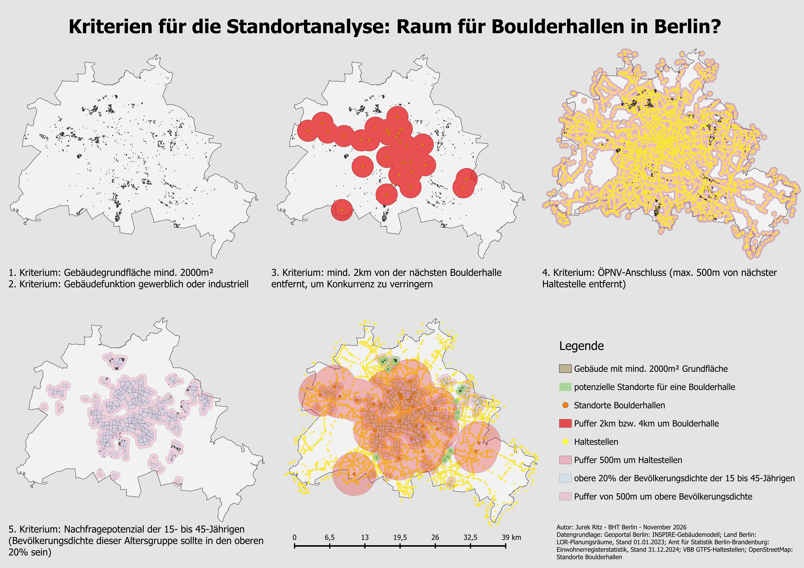
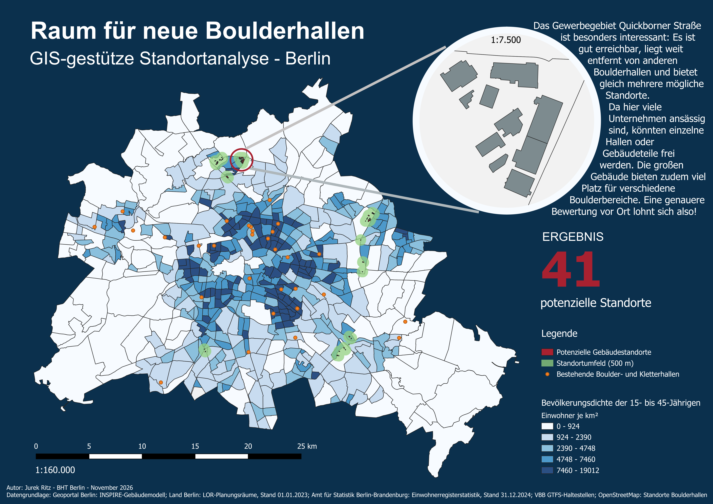

# Grundlagen der Geoinformationssysteme
## Monitoring der sozialen Stadtentwicklung (2025)

## Bevölkerungsverteilung in den lebensweltlich orientierten Räumen Berlin (2019)

# Standortanalyse
GIS-gestützte Standortanalyse für Berlin: Raum für neue Boulderhallen
## Kriterien der Standortanalyse

[Die Karte als PDF ansehen](Kriterien_Standortanalyse_Boulderhalle.pdf)
## Ergebnis der Standortanalyse

[Die Karte als PDF ansehen](Standortanalyse_Boulderhalle_Berlin.pdf)
