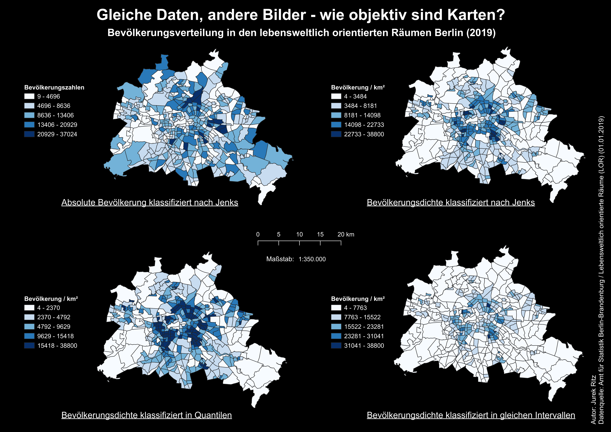

# Grundlagen der Geoinformationssysteme
## Monitoring der sozialen Stadtentwicklung (2025)

## Bevölkerungsverteilung in den lebensweltlich orientierten Räumen Berlin (2019)

# Standortanalyse
GIS-gestützte Standortanalyse für Berlin: Raum für neue Boulderhallen
## Projektbeschreibung und Zielsetzung
Seit einigen Jahren gewinnt Bouldern, also das Klettern ohne Hilfsmittel in verhältnismäßig geringer Höhe, enorm an Beliebtheit. Insbesondere in Berlin ist die Nachfrage sehr groß, weshalb eine neue, gut gelegene Boulderhalle durchaus lukrativ laufen könnte. Ziel dieser Standortanalyse ist es, Bestandsgebäude innerhalb Berlins zu finden, welche potenziell zu einer Boulderhalle umgebaut werden könnten. Dabei soll die Analyse eher als Vorauswahl dienen, damit nachfolgend vor Ort die Verfügbarkeit und bauliche Eignung überprüft werden können.

## Datengrundlage
Senatsverwaltung für Stadtentwicklung, Bauen und Wohnen Berlin: ALKIS Berlin Gebäude. Web Feature Service (WFS), Layer alkis_gebaeude:gebaeude. Geoportal Berlin. Lizenz: Datenlizenz Deutschland - Zero 2.0. [21.11.2026]

c OpenStreetMap-Mitwirkende: Standorte bestehender Boulderhallen Berlin. OpenStreetMap, Lizenz: Open Database License (ODbL) 1.0. [21.11.2026]

VBB Verkehrsbund Berlin-Brandenburg GmbH: VBB-Fahrplandaten (GTFS), Datei stops.txt. Haltestellenkoordinaten des Verkehrsbundes Berlin-Brandenburg. Lizenz: Creative Commons Attribution 4.0 International (CC BY 4.0). [21.11.2026]

Senatsverwaltung für Stadtentwicklung, Bauen und Wohnen Berlin: Lebensweltlich orientierte Räume (LOR), Planungsräume der seit 01.01.2021 geltenden Gebietsgliederung. [21.11.2026]

Eigene Weiterverarbeitung und Verknüpfung der Daten in QGIS.

## Kriterien der Standortanalyse
Für die Standortanalyse in QGIS wurde sich auf fünf Kriterien fokussiert.

1. Gebäudegrundfläche: Die Fläche des Bestandgebäudes, in welche die Boulderhalle gebaut werden soll, beträgt mindestens 2000m². Dies ist daraus abgeleitet, dass Boulderhallen im Schnitt eine Fläche von 1500m² bis 3000m² haben.

2. Gebäudefunktion: Die vorhandene Nutzung muss geeignet sein. Das bedeutet, dass das Gebäude überwiegend gewerblich oder industriell genutzt werden sollte. Zum Einen, weil eine Boulderhalle letztlich ein gewerbliches Freizeitangebot ist, zum anderen aber auch, weil Industrie- und Gewerbegebäude häufig baulich geeigneter für eine Boulderhalle sind, als beispielsweise Wohngebäude.

3. Konkurrenzsituation: Die Boulderhalle sollte mind. 2km vom nächsten Boulder- oder Kletterangebot entfernt sein, damit sie sich wirtschaftlich etablieren kann und idealerweise einen "Versorgungsengpass" stillt. 

4. ÖPNV-Anbindung: Die nächste Haltestelle sollte maximal 500m von der Boulderhalle entfernt sein, um die Erreichbarkeit sicherzustellen.

5. Demografisches Nachfragepotenzial: Bei einer Aufteilung in Quantile der Bevölkerungsdichte von 15- bis 45-Jährigen sollte die Boulderhalle entweder in oder 500m entfernt von einem Raum der oberen 20% liegen.

6. Bauliche Eignung und Verfügbarkeit: Dies ist kein Bestandteil der GIS-gestützten Standortanalyse mehr. Die Idee ist, dass man zum Schluss vor Ort die einzelnen Gebäude nach ihrer inneren Raumhöhe, Geometrie und Verfügbarkeit individuell bewerten kann.

Während der Bearbeitung ist aufgefallen, dass trotz dieser Kriterien noch knapp 160 Gebäude bei Beendigung der Analyse als nächster Boulderhallenstandort infrage kamen. Da dies für eine händische Bewertung noch zu viele sind, habe ich das dritte Kriterium, die Konkurrenzsituation auf 4km bis zur nächsten Boulderhalle angepasst und die potenziellen Gebäude auf 41 verringert. Sollte sich unter diesen bei der fiktiven Bewertung vor Ort keines als geeignet herausstellen, halte ich es für sinnvoll, eben dieses dritte Kriterium wieder nach unten hin anzupassen.

[Die Karte als PDF ansehen](Kriterien_Standortanalyse_Boulderhalle.pdf)

## Methodisches Vorgehen
## Ergebnis der Standortanalyse

[Die Karte als PDF ansehen](Standortanalyse_Boulderhalle_Berlin.pdf)
