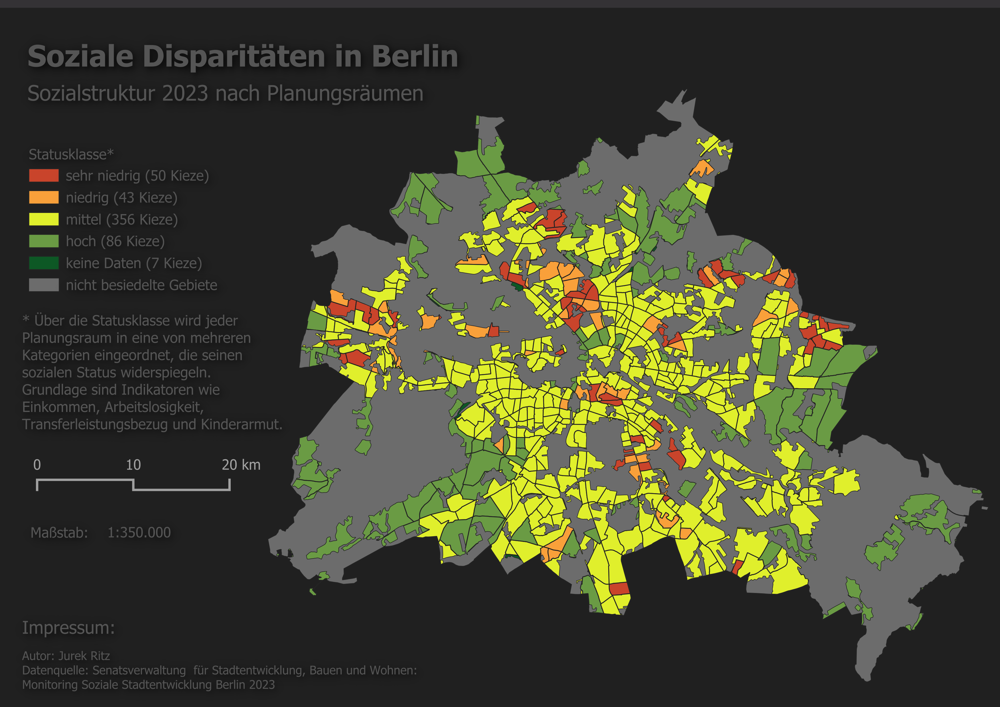

# Grundlagen der Geoinformationssysteme
## Monitoring der sozialen Stadtentwicklung (2025)

## Bevölkerungsverteilung in den lebensweltlich orientierten Räumen Berlin (2019)

# Standortanalyse
GIS-gestützte Standortanalyse für Berlin: Raum für neue Boulderhallen
## Projektbeschreibung und Zielsetzung
Seit einigen Jahren gewinnt Bouldern, also das Klettern ohne Hilfsmittel in verhältnismäßig geringer Höhe, enorm an Beliebtheit. Insbesondere in Berlin ist die Nachfrage sehr groß, weshalb eine neue, gut gelegene Boulderhalle durchaus lukrativ laufen könnte. Ziel dieser Standortanalyse ist es, Bestandsgebäude innerhalb Berlins zu finden, welche potenziell zu einer Boulderhalle umgebaut werden könnten. Dabei soll die Analyse eher als Vorauswahl dienen, damit nachfolgend vor Ort die Verfügbarkeit und bauliche Eignung überprüft werden kann.

## Kriterien der Standortanalyse
Für die Standortanalyse in QGIS wurde sich auf fünf Kriterien fokussiert, zusätzlich ist noch ein sechstes Kriterium angedacht.

1. Gebäudegrundfläche: Die Fläche des Bestandgebäudes, in welche die Boulderhalle gebaut werden soll, beträgt mindestens 2000m². Dies ist daraus abgeleitet, dass Boulderhallen im Schnitt eine Fläche von 1500m² bis 3000m² haben.

2. Gebäudefunktion: Die vorhandene Nutzung muss geeignet sein. Das bedeutet, dass das Gebäude überwiegend gewerblich oder industriell genutzt werden sollte. Zum Einen, weil eine Boulderhalle letztlich ein gewerbliches Freizeitangebot ist, zum anderen aber auch, weil Industrie- und Gewerbegebäude häufig baulich geeigneter für eine Boulderhalle sind, als beispielsweise Wohngebäude.

3. Konkurrenzsituation: Die Boulderhalle sollte mind. 2km (später auf 4km erweitert) vom nächsten Boulder- oder Kletterangebot entfernt sein, damit sie sich wirtschaftlich etablieren kann und idealerweise einen "Versorgungsengpass" stillt. 

4. ÖPNV-Anbindung: Die nächste Haltestelle sollte maximal 500m von der Boulderhalle entfernt sein, um die Erreichbarkeit sicherzustellen.

5. Demografisches Nachfragepotenzial: Bei einer Aufteilung in Quantile der Bevölkerungsdichte von 15- bis 45-Jährigen sollte die Boulderhalle entweder in oder 500m entfernt von einem Raum der oberen 40% liegen, da besonders bei jungen Menschen eine höhere Nachfrage vorhanden ist.

6. Bauliche Eignung und Verfügbarkeit: Gebäudehöhe, Innenraumhöhe, Eigentumsverhältnisse, Baurecht etc. Dies ist kein Teil der GIS-gestützten Standortanalyse mehr und sollte direkt vor Ort und mit Eigenrecherche individuell für jedes Gebäude untersucht werden.

[Die Karte als PDF ansehen](Kriterien_Standortanalyse_Boulderhalle.pdf)

## Methodisches Vorgehen
Da es das Ziel dieser Standortanalyse ist, geeignete Bestandsgebäude zu finden, habe ich als erstes die ALKIS-Gebäudedaten über einen WFS in QGIS eingebunden und alle Gebäude mit einer Grundfläche von 2000m² oder mehr ausgewählt. 

Die nächste Einschränkung erfolgte anschließend über die Gebäudefunktion: Hier habe ich wieder nur die Gebäude, welche überwiegend gewerblich oder industriell genutzt werden, ausgewählt. 
Daraus ergab sich dann ein erheblich reduzierter Datensatz mit überwiegend Lagerhallen, Werkstätten, Fabriken oder anders genutzten Gewerbeflächen.

Anschließend habe ich die Standorte bestehender Boulder- und Kletterhallen als Punktdaten eingebunden und eine Pufferzone von 2km (später 4km) um diese Punkte erstellt. Mit dem QGIS-Werkzeug "Nach Position selektieren" wurden Gebäude innerhalb dieser Bereiche ausgeschlossen, um Standorte mit größerem Abstand zum bereits bestehenden Angebot zu finden.

Danach habe ich die ÖPNV-Anbindung untersucht, für welche ich die Haltestellendaten implementiert habe und auch um diese einen "Fußweg"-Puffer von 500m erstellt habe. Beim anschließenden Selektieren habe ich wieder nur Gebäude innerhalb dieses Bereiches berücksichtigt. 

Im nächsten Schritt habe ich die Einwohnerregisterdaten von 2024 mit den Berliner LOR-Planungsräumen verknüpft und die Bevölkerungsdichte der 15- bis 45-Jährigen berechnet. Hier habe ich dann die 40% der Planungsräume mit der höchsten Dichte ausgewählt und ebenfalls mit 500m gepuffert, um den Bereich innerhalb einer potenziellen Wegezeit für Anwohner zu berücksichtigen. Auch hier habe ich dann die Gebäudeauswahl anhand der räumlichen Überschneidung getroffen.

Letztendlich blieben nach der schrittweisen Kombination und auch Anpassung aller Kriterien 41 potenziell geeignete Gebäude. Da diese mithilfe räumlicher Selektion ausgewählt wurden, blieben ihre Grundrisse vollständig erhalten.

### Problematik und Grenzen der Analyse
Teilweise eliminierten einzelne Kriterien weitaus weniger Gebäude, als ich zunächst angenommen hatte. So hat das Kriterium der Erreichbarkeit von Haltestellen nur ungefähr 25 Gebäude als Standort ausgeschlossen. Dies liegt an der großen Anzahl der Haltestellen, die ich undifferenziert alle übernommen habe. Als Verbesserung würde ich nächstes Mal wahrscheinlich zwischen den verschiedenen Verkehrsmitteln des ÖPNV unterscheiden, um hier ein aussagekräftigeres Ergebnis zu erhalten. Gerade hier wäre auch eine unterschiedliche Gewichtung von S-Bahn, U-Bahn, Straßenbahn oder Bus angebracht.

Während der Bearbeitung ist außerdem aufgefallen, dass trotz aller Kriterien noch knapp 160 Gebäude bei Beendigung der Analyse als nächster Boulderhallenstandort infrage kamen. Da dies für eine händische Bewertung noch zu viele sind, habe ich das dritte Kriterium, die Konkurrenzsituation, auf 4km Luftlinie bis zur nächsten Boulderhalle angepasst und so die potenziellen Gebäude auf 41 verringert. Sollte sich unter diesen bei der Bewertung vor Ort keines als geeignet herausstellen, halte ich es für sinnvoll, eben dieses dritte Kriterium wieder nach unten hin anzupassen.

Ursprünglich hatte ich zudem auch geplant die Gebäudehöhe bzw. innere Raumhöhe in QGIS zu beachten. Jedoch habe ich hierfür keinen entsprechenden und insbesondere vollständigen Datensatz gefunden, dieses Kriterium also wieder verworfen. Ein ähnliches Problem hatte ich, als ich die momentane Nutzung und somit vielleicht leerstehende und ungenutzte Gebäude herausfinden wollte: Auch hierzu habe ich keine zufriedenstellenden Daten gefunden.

Dennoch konnte ich mit den genutzten Daten durchaus eine Vorauswahl treffen.

## Ergebnis der Standortanalyse

[Die Karte als PDF ansehen](Standortanalyse_Boulderhalle_Berlin.pdf)

Das Ergebnis meiner Analyse sind 41 potenzielle Standorte für eine Boulderhalle in Form von Bestandsgebäuden. 

Auffällig ist hierbei, dass diese weniger einzeln in Berlin verteilt sind, sondern eher "Cluster" bilden, was vermutlich an der Auswahl der Gebäudefunktion liegt, da mehrere flächenmäßig größere Gebäude eben typisch für Gewerbe- und Industrieflächen sind. Hervorzuheben ist hier insbesondere das Gewerbegebiet Quickborner Straße im Norden der Stadt, da es, anders als andere potenzielle Standorte, nicht zwischen mehreren schon bestehenden Boulder- und Kletterhallen liegt und deshalb durchaus eine Angebotslücke darstellen könnte.

Das GIS-Verfahren eignet sich meiner Meinung nach zu einer Vorauswahl für potenzielle Standpunkte, birgt aber eben auch die Gefahr,  gut gelegene Standorte durch einen schnellen vollständigen Ausschluss zu übersehen. Dieses Problem wäre durch eine Gewichtung der Kriterien zu umgehen, da Standorte so nicht vollständig ausgeschlossen werden, sondern eben eher als geeignet oder weniger geeignet kategorisiert werden.

Des Weiteren reicht die Standortanalyse selbstverständlich nicht aus, um wirklich einen passenden Standort zu finden, da zu viele wichtige Kriterien weiterhin offen bleiben: Sind die Räume im Gebäude hoch genug? Darf umgebaut werden? Ist das Gebäude frei?

Als nächsten Schritt müsste man nun also die einzelnen Gebäude ihrer Tauglichkeit nach bewerten. Und hierfür liefert die Standortanalyse bereits eine solide Grundlage.

## Datengrundlage
Senatsverwaltung für Stadtentwicklung, Bauen und Wohnen Berlin: ALKIS Berlin Gebäude. Web Feature Service (WFS), Layer alkis_gebaeude:gebaeude. Geoportal Berlin. Lizenz: Datenlizenz Deutschland - Zero 2.0. [21.11.2026]

c OpenStreetMap-Mitwirkende: Standorte bestehender Boulderhallen Berlin. OpenStreetMap, Lizenz: Open Database License (ODbL) 1.0. [21.11.2026]

VBB Verkehrsbund Berlin-Brandenburg GmbH: VBB-Fahrplandaten (GTFS), Datei stops.txt. Haltestellenkoordinaten des Verkehrsbundes Berlin-Brandenburg. Lizenz: Creative Commons Attribution 4.0 International (CC BY 4.0). [21.11.2026]

Senatsverwaltung für Stadtentwicklung, Bauen und Wohnen Berlin: Lebensweltlich orientierte Räume (LOR), Planungsräume der seit 01.01.2021 geltenden Gebietsgliederung. [21.11.2026]

Amt für Statistik Berlin-Brandenburg: Einwohnerregisterstatistik Berlin, Einwohnerinnen und Einwohner in Lebensweltlich orientierten Räumen (LOR), Stand 31.12.2024. [21.11.2026]

Eigene Weiterverarbeitung und Verknüpfung der Daten in QGIS.
